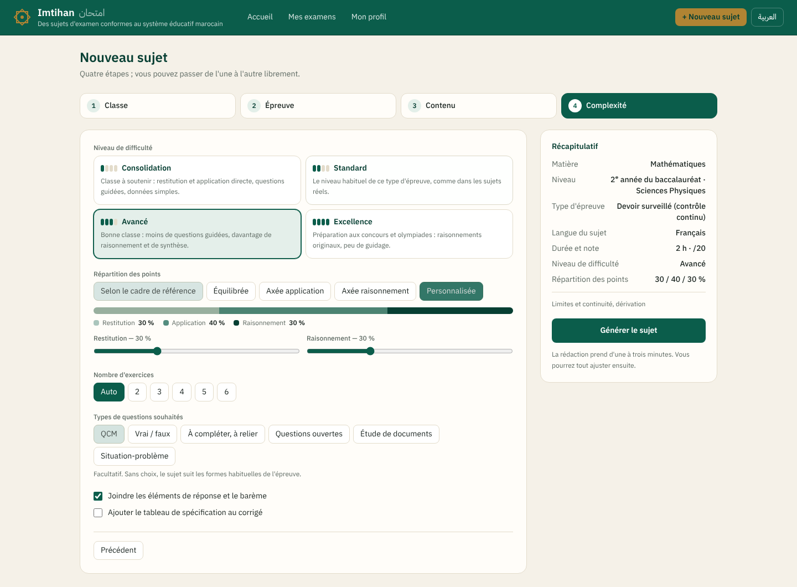
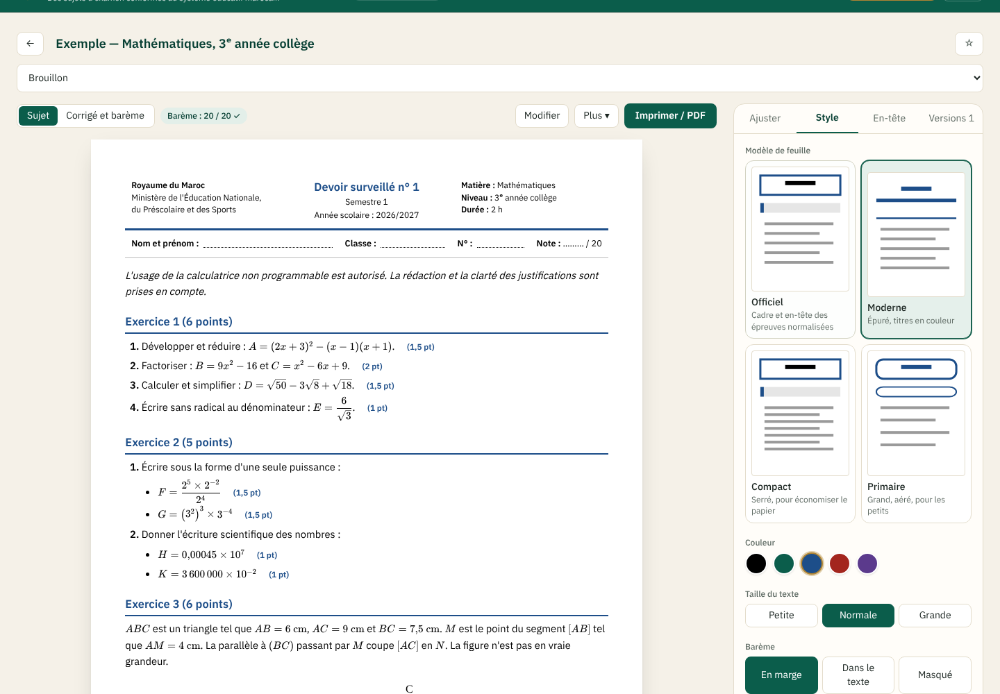
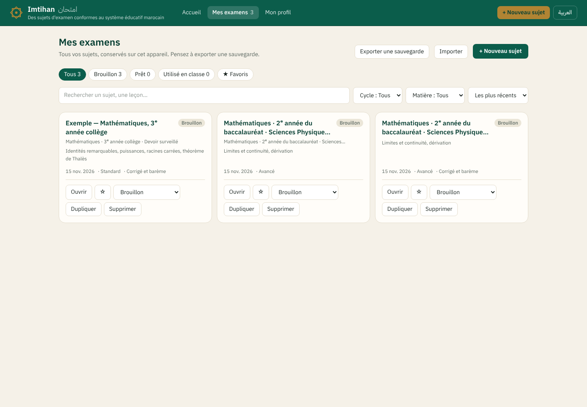
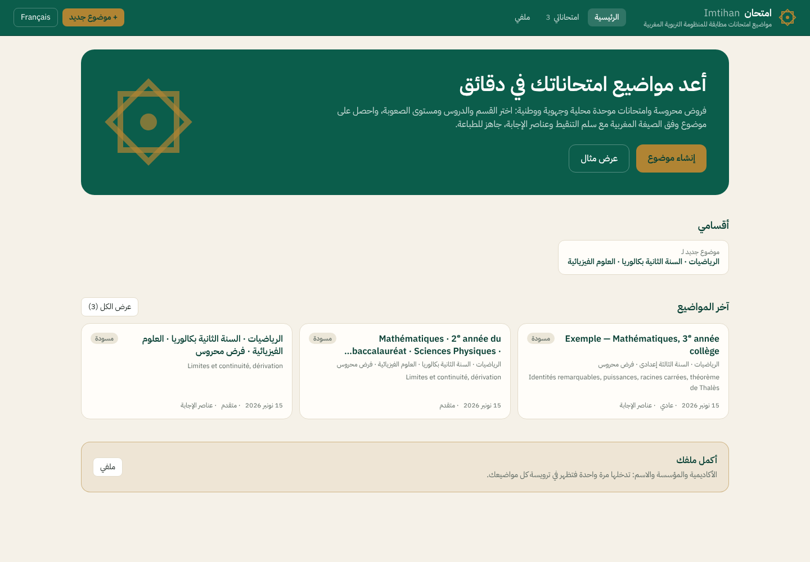

# Imtihan — امتحان

**An exam generator for Moroccan teachers.** Pick the level, the track, the subject and the type
of exam; Imtihan writes a paper in the format used in Moroccan schools, with its marking guide,
ready to print.

> **Français** — Imtihan rédige des sujets d'examen conformes au système éducatif marocain, pour
> chaque niveau, chaque filière et chaque matière, avec barème et éléments de réponse.
>
> **العربية** — «امتحان» موقع يساعد الأساتذة المغاربة على إعداد مواضيع الامتحانات وفق المنظومة
> التربوية المغربية، لكل مستوى ومسلك ومادة، مع عناصر الإجابة وسلم التنقيط.

| Choosing the complexity | The exam workspace |
| --- | --- |
|  |  |

| The exam library | Arabic interface |
| --- | --- |
|  |  |

## What a teacher can do

### Create a paper in four steps

1. **Class** — cycle, level, track, subject and language of the paper. Classes can be saved
   and reused in one click.
2. **Exam** — devoir surveillé, diagnostic test, or local, provincial, regional or national
   standardized exam; semester or session, duration, total mark, coefficient.
3. **Content** — the lessons to assess and any special instructions.
4. **Complexity** — see below.

### Choose the complexity

- **Four difficulty levels**: consolidation, standard, advanced, excellence (competitive exams
  and olympiads).
- **Balance of the marks** between restitution, application and reasoning: follow the official
  framework, pick a preset, or set your own percentages.
- **Number of exercises** and **question formats** (QCM, true/false, fill-in and matching, open
  questions, document study, situation-problème).
- Optional **table of specification** (tableau de spécification) added to the marking guide.

### Adjust the paper

- Ask for a change in one sentence, or use one-click changes: easier, harder, shorter, new
  numerical data, add a QCM, Moroccan context.
- Edit the text directly, with a live preview.
- **Sujet B**: a parallel version with the same structure and marks but different data, for
  pupils sitting side by side.
- A **marks check** adds up the points in the paper and compares them with the total.
- **Version history**: every writing, adjustment and manual edit is kept and can be restored.

### Redesign the sheet

- Four templates: **Officiel**, **Moderne**, **Compact**, **Primaire**.
- Accent colour, text size, marks in the margin, in the text or hidden.
- School logo, name/class/mark line, ruled answer lines under each question, closing line.
- Any style can be made the default for future papers. Restyling never rewrites the content.

### Manage exams

- A library with search, filters by status, cycle and subject, favourites and sorting.
- Title, status (draft, ready, used in class), duplicate, delete.
- Header details (academy, school, duration, coefficient…) editable per exam without rewriting.
- **Backup and restore** of all exams as a file; download of a single paper as text.
- A **profile** entered once: academy, direction, school, teacher's name, logo, saved classes.

### Everywhere

- Every level of the Moroccan system: primary (1st–6th), collège (1AC–3AC), lycée (tronc commun,
  1st and 2nd bac) with their tracks, including enseignement originel and bac professionnel.
- Papers in Arabic, French or English, with LaTeX mathematics, tables and figures.
- Print or save as PDF in A4: the paper, the marking guide, or both.
- Interface in French and Arabic, usable on a phone. No accounts: data stays in the browser.

## Important

The papers are written by an AI model (Claude, by Anthropic) from its knowledge of the Moroccan
programmes and cadres de référence. They are **not official exams**, and no official document is
loaded into the site. A teacher must review the questions, the data and the marks before giving
a paper to pupils.

## Quick start

You need Node.js 20 or later and an [Anthropic API key](https://console.anthropic.com).

```bash
git clone https://github.com/badrddinb/Edu.git
cd Edu
npm install
cp .env.example .env.local   # then set ANTHROPIC_API_KEY
npm run dev                  # http://localhost:3000
```

Without an API key the site still opens: **Voir un exemple** adds a hand-written sample paper,
so you can try the workspace, the templates and printing.

## Configuration

| Variable | Required | Purpose |
| --- | --- | --- |
| `ANTHROPIC_API_KEY` | yes | Anthropic API key. Used on the server only, never sent to the browser. |
| `ACCESS_CODE` | no | A code teachers must enter before generating. Set it on any public deployment: without it, every visitor can spend your API key. |
| `ANTHROPIC_MODEL` | no | Model used to write the papers. Defaults to `claude-opus-5-5`. |

## Deployment

Imtihan is a standard Next.js application.

```bash
npm run build
npm start
```

It runs on Vercel or any Node.js host once the variables above are set. Writing a full paper
with its marking guide can take a few minutes, so the host must allow long responses; the
generation route asks for up to 300 seconds.

## How it works

1. The form builds an exam description from the curriculum data in `src/lib/curriculum.ts`.
2. The server validates it, then asks Claude for the paper, giving it the conventions of
   Moroccan exams and the usual structure of that subject's paper (`src/lib/prompt.ts`).
3. The paper is streamed back as Markdown and rendered on an A4 sheet. The official header is
   printed by the site from the teacher's settings, not by the model.

## Project structure

| Path | Contents |
| --- | --- |
| `src/app/` | Routes: home, `/nouveau` (creation), `/examens` (library), `/examens/[id]` (workspace), `/profil`, and the API |
| `src/lib/curriculum.ts` | Cycles, levels, tracks, subjects, exam types, difficulty levels, regional academies |
| `src/lib/prompt.ts` | Instructions to the model and the usual structure of each paper |
| `src/lib/store.tsx` | The teacher's exams, profile and settings, kept in the browser |
| `src/lib/i18n.ts` | Interface and paper labels in French, Arabic and English |
| `src/lib/validate.ts` | Server-side validation of the teacher's request |
| `src/app/api/generate/route.ts` | Call to the Claude API, streamed to the browser |
| `src/components/Wizard.tsx` | The four-step creation screen |
| `src/components/Editor.tsx` | The exam workspace: adjust, style, header, versions |
| `src/components/Library.tsx` | The exam library |
| `src/components/Paper.tsx`, `StylePanel.tsx` | The exam sheet and its templates (styles in `src/app/globals.css`) |

To add a subject or a track, edit `src/lib/curriculum.ts`. To change how a subject's paper is
structured, edit `structureHint` in `src/lib/prompt.ts`.

## Scripts

| Command | Action |
| --- | --- |
| `npm run dev` | Start the development server |
| `npm run build` | Build for production |
| `npm start` | Serve the production build |
| `npm run lint` | Check the code with ESLint |

## Limits

- The subject lists per track, the usual paper structures, and the default durations are a
  starting point written from general knowledge; have a teacher check them for your subjects.
- Coefficients are entered by the teacher, not filled in from official tables.
- Exams, profile and logo live in one browser. Use the backup file to move them to another
  device; clearing the browser's data deletes them.
- Figures are drawn by the model and should be checked like the rest of the paper.
