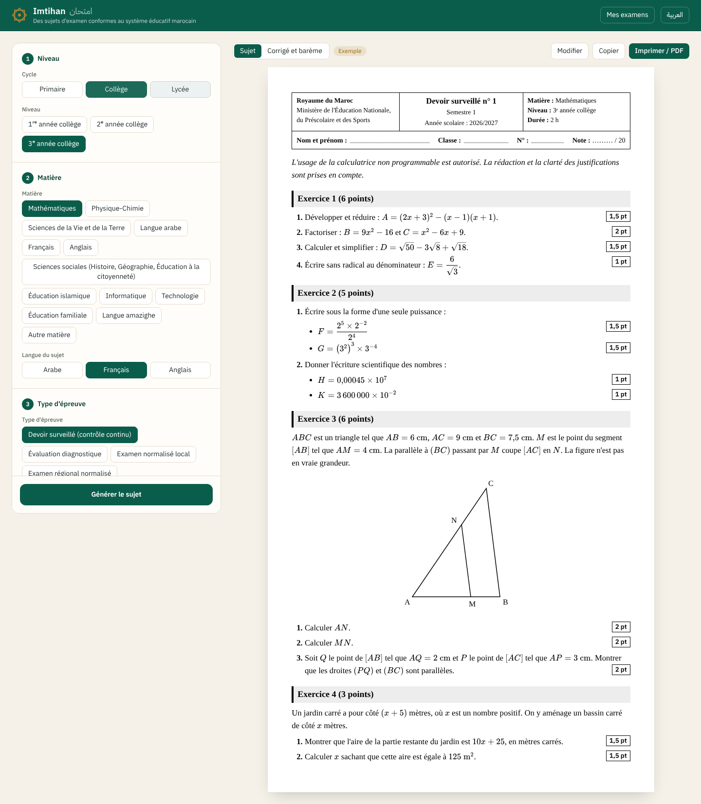
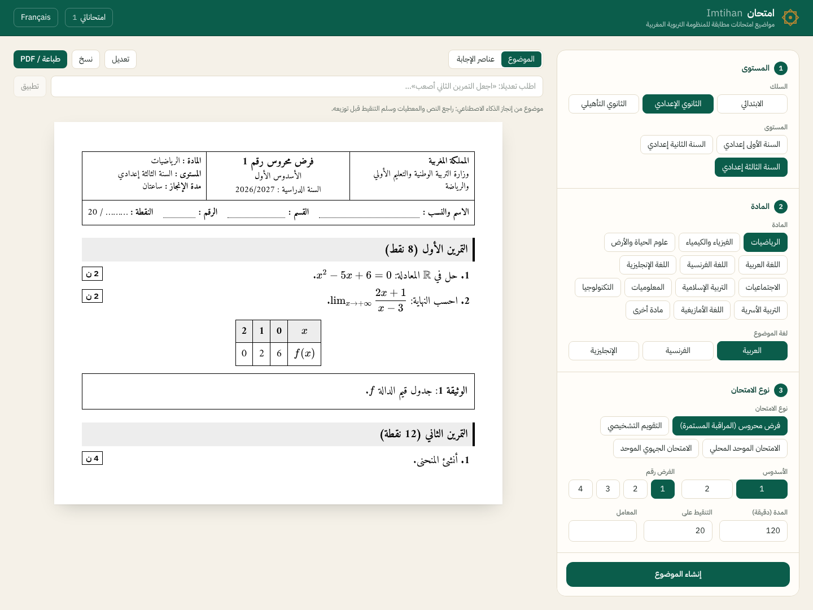

# Imtihan — امتحان

**An exam generator for Moroccan teachers.** Pick the level, the track, the subject and the type
of exam; Imtihan writes a paper in the format used in Moroccan schools, with its marking guide,
ready to print.

> **Français** — Imtihan rédige des sujets d'examen conformes au système éducatif marocain, pour
> chaque niveau, chaque filière et chaque matière, avec barème et éléments de réponse.
>
> **العربية** — «امتحان» موقع يساعد الأساتذة المغاربة على إعداد مواضيع الامتحانات وفق المنظومة
> التربوية المغربية، لكل مستوى ومسلك ومادة، مع عناصر الإجابة وسلم التنقيط.

| French paper | Arabic paper, Arabic interface |
| --- | --- |
|  |  |

## Features

- **Every level of the Moroccan system**
  - Primary: 1st to 6th year
  - Collège: 1AC to 3AC
  - Lycée: tronc commun, 1st and 2nd year of the baccalauréat, with their tracks — sciences
    expérimentales, sciences mathématiques A and B, sciences physiques, SVT, sciences
    agronomiques, économie et gestion, lettres, sciences humaines, STE, STM, arts appliqués,
    enseignement originel, bac professionnel
- **Every exam type**, offered according to the level: devoir surveillé (contrôle continu),
  diagnostic test, and the local, provincial, regional and national standardized exams
- **Papers in Arabic, French or English**, with the official header (academy, provincial
  direction, school, duration, coefficient), LaTeX mathematics, tables and figures
- **Marking guide** (éléments de réponse et barème) for every question
- **Revisions**: ask for a change in one sentence ("make exercise 2 harder"), or edit the text
  directly with a live preview
- **Print or save as PDF** in A4: the paper, the marking guide, or both
- **Interface in French and Arabic**, usable on a phone
- **Saved exams** are kept in the teacher's browser; there are no accounts

## Important

The papers are written by an AI model (Claude, by Anthropic) from its knowledge of the Moroccan
programmes and cadres de référence. They are **not official exams**, and no official document is
loaded into the site. A teacher must review the questions, the data and the marks before giving
a paper to pupils.

## Quick start

You need Node.js 20 or later and an [Anthropic API key](https://console.anthropic.com).

```bash
git clone https://github.com/badrddinb/Edu.git
cd Edu
npm install
cp .env.example .env.local   # then set ANTHROPIC_API_KEY
npm run dev                  # http://localhost:3000
```

Without an API key the site still opens: **Voir un exemple** shows a hand-written sample paper,
so you can judge the layout and printing.

## Configuration

| Variable | Required | Purpose |
| --- | --- | --- |
| `ANTHROPIC_API_KEY` | yes | Anthropic API key. Used on the server only, never sent to the browser. |
| `ACCESS_CODE` | no | A code teachers must enter before generating. Set it on any public deployment: without it, every visitor can spend your API key. |
| `ANTHROPIC_MODEL` | no | Model used to write the papers. Defaults to `claude-opus-5-5`. |

## Deployment

Imtihan is a standard Next.js application.

```bash
npm run build
npm start
```

It runs on Vercel or any Node.js host once the variables above are set. Writing a full paper
with its marking guide can take a few minutes, so the host must allow long responses; the
generation route asks for up to 300 seconds.

## How it works

1. The form builds an exam description from the curriculum data in `src/lib/curriculum.ts`.
2. The server validates it, then asks Claude for the paper, giving it the conventions of
   Moroccan exams and the usual structure of that subject's paper (`src/lib/prompt.ts`).
3. The paper is streamed back as Markdown and rendered on an A4 sheet. The official header is
   printed by the site from the teacher's settings, not by the model.

## Project structure

| Path | Contents |
| --- | --- |
| `src/lib/curriculum.ts` | Cycles, levels, tracks, subjects, exam types, regional academies |
| `src/lib/prompt.ts` | Instructions to the model and the usual structure of each paper |
| `src/lib/i18n.ts` | Interface and paper labels in French, Arabic and English |
| `src/lib/validate.ts` | Server-side validation of the teacher's request |
| `src/app/api/generate/route.ts` | Call to the Claude API, streamed to the browser |
| `src/components/ExamForm.tsx` | The teacher's form |
| `src/components/Paper.tsx` | The exam sheet: header, paper, marking guide |
| `src/components/Markdown.tsx` | Rendering of mathematics, tables and figures |

To add a subject or a track, edit `src/lib/curriculum.ts`. To change how a subject's paper is
structured, edit `structureHint` in `src/lib/prompt.ts`.

## Scripts

| Command | Action |
| --- | --- |
| `npm run dev` | Start the development server |
| `npm run build` | Build for production |
| `npm start` | Serve the production build |
| `npm run lint` | Check the code with ESLint |

## Limits

- The subject lists per track, the usual paper structures, and the default durations are a
  starting point written from general knowledge; have a teacher check them for your subjects.
- Coefficients are entered by the teacher, not filled in from official tables.
- Saved exams live in one browser and do not follow the teacher to another device.
- Figures are drawn by the model and should be checked like the rest of the paper.
